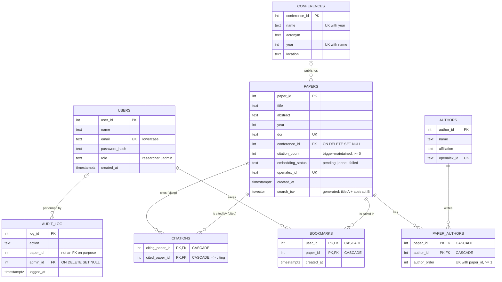

# ER Diagram and Relational Schema

The diagram is written in Mermaid, so GitHub and VS Code (with a Mermaid extension) render it automatically. For the report, paste it into https://mermaid.live and export it as PNG or SVG.

## Relationships

| Relationship | Type | How it is stored |
|---|---|---|
| Conference publishes Paper | 1 : N (optional on the paper side) | `papers.conference_id` FK, `ON DELETE SET NULL` |
| Paper written by Author | M : N | Junction table `paper_authors`, plus `author_order` |
| Paper cites Paper | M : N, recursive (self-referencing) | Junction table `citations`, with two FKs to `papers` |
| User bookmarks Paper | M : N | Junction table `bookmarks`, plus `created_at` |
| Admin deletes Paper (logged) | 1 : N | `audit_log.admin_id` FK; `paper_id` is kept without an FK |

## Normalisation notes (up to 3NF)

- **1NF.** Every column holds a single value. Authors and citations are not stored as lists inside a paper row (no `authors TEXT[]`); each one gets its own row in `paper_authors` or `citations`. `search_tsv` is a derived search index computed by the database, not user data.
- **2NF.** Every table with a composite key (`paper_authors`, `citations`, `bookmarks`) has no attribute that depends on only part of the key:
  - `author_order` depends on the pair (paper, author).
  - `created_at` on a bookmark depends on the pair (user, paper).
  - Author details (name, affiliation) live in `authors`, not in `paper_authors`.
- **3NF.** No non-key attribute depends on another non-key attribute:
  - Conference name, acronym and location are stored once in `conferences`. Papers only carry `conference_id`, so a conference rename is a one-row update.
  - User role and email live only in `users`. Bookmarks reference the user by id.
- **Controlled redundancy: `papers.citation_count`.** This equals `COUNT(*)` of matching `citations` rows. It is a deliberate denormalisation for read speed: search results and the dashboard sort by it constantly. Triggers keep it correct, so it can never disagree with the `citations` table. A CHECK keeps it from going below 0.
